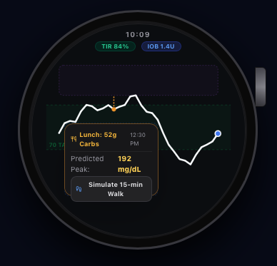
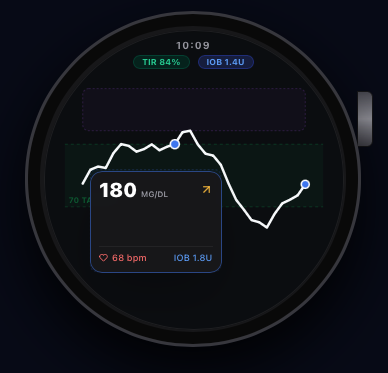
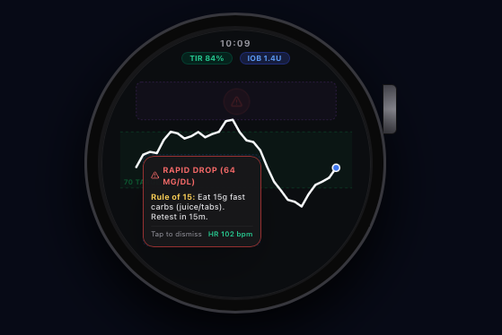
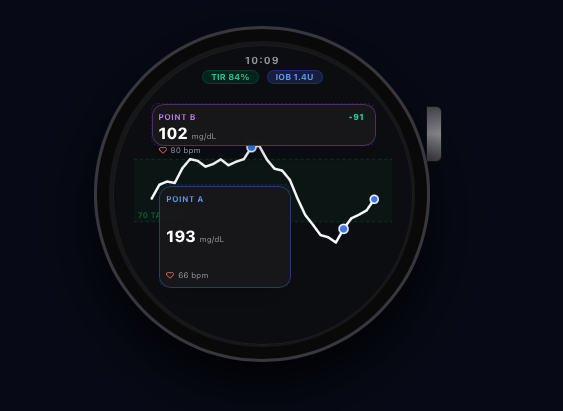
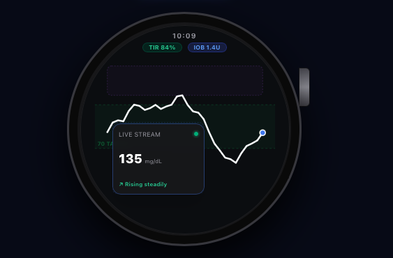

# Glymmy

> **Your glycemic companion — AI health platform**  
> _(glycemic + my — a unified health data platform)_

Glymmy connects CGM, wearables, food photos, and lab reports into one AI-powered health companion. It uses the multimodal **Gemma 4** model to turn raw clinical data into personalized, actionable insights — running locally by default, with zero paid dependencies.

Built for the **Harvard HSIL Hackathon 2026**.

---

## What it does

| Feature | Description |
|---|---|
| **CGM Dashboard** | Real-time glucose time-series, time-in-range (TIR), hypo/hyper alerts |
| **Smartwatch UI (SF-LG)** | Circular 300x300 watch interface with **Space-Filling Line Graph (SF-LG)** greedy space allocation for post-meal walk advice & vitals |
| **Food Scanner** | Photo or text → full nutrition breakdown + AI post-prandial glucose spike prediction |
| **Lab Interpreter** | AI interpretation of blood reports with risk assessment |
| **Wearable Sync** | CGM, Apple Watch, Garmin HR monitor, Fitbit activity tracker (HR, steps, sleep, SpO2) |
| **RAG Chat** | Ask questions about your health data with cited clinical sources |
| **FHIR QR Share** | Generate a QR code containing a FHIR bundle for doctor visits in 10 seconds |
| **Real-time Alerts** | Multi-level alerts (Rule of 15 rescue protocol) & SSE push notifications |

---

## System Architecture: Bidirectional Data Flow

Glymmy operates on a **closed-loop feedback architecture**: devices act as continuous physiological emitters (**Giving Side**), while the local AI engine processes correlations and delivers actionable micro-interventions back to the patient and clinician (**Receiving & Acting Side**).

```
┌─────────────────────────────────────────────────────────────────────────────────────────────┐
│                       1. SENSOR & INGESTION LAYER (GIVING / SENSING SIDE)                   │
│                                                                                             │
│  ┌──────────────────┐    ┌──────────────────┐    ┌──────────────────┐    ┌────────────────┐ │
│  │    CGM Sensor    │    │ Smartwatch Vitals│    │ Phone Camera/Scan│    │  Blood Reports │ │
│  │ (Dexcom / Libre) │    │ (Apple / Garmin) │    │ (Food Photo/Log) │    │  (Lab PDF/OCR) │ │
│  │  Glucose 5m BLE  │    │  HR, Steps, Temp │    │ Macro Estimation │    │  HbA1c, Lipids │ │
│  └────────┬─────────┘    └────────┬─────────┘    └────────┬─────────┘    └────────┬───────┘ │
└───────────┼───────────────────────┼───────────────────────┼───────────────────────┼─────────┘
            │                       │                       │                       │
            └───────────────────────┼───────────────────────┴───────────────────────┘
                                    ▼
┌─────────────────────────────────────────────────────────────────────────────────────────────┐
│                          2. CORE PROCESSING & PREDICTIVE ENGINE                             │
│                                                                                             │
│                     ┌───────────────────────────────────────────────┐                       │
│                     │       FastAPI Backend (:8000)                 │                       │
│                     │  • Time-Series Normalization (Dubosson)       │                       │
│                     │  • Post-Meal Spike Kinetics & Walk Blunting   │                       │
│                     │  • Rule-of-15 Hypo Threshold Engine (SSE)     │                       │
│                     └───────┬───────────────────────────────┬───────┘                       │
│                             │                               │                               │
│              ┌──────────────┴──────────────┐ ┌──────────────┴──────────────┐                │
│              │    Gemma 4 Multimodal LLM   │ │  ChromaDB Vector Store RAG  │                │
│              │   Local Vision & Inference  │ │ Clinical Context Retrieval  │                │
│              └─────────────────────────────┘ └─────────────────────────────┘                │
└─────────────────────────────────────────────┬───────────────────────────────────────────────┘
                                              │
                      ┌───────────────────────┴───────────────────────┐
                      ▼                                               ▼
┌───────────────────────────────────────────┐   ┌───────────────────────────────────────────┐
│  3. REAL-TIME INTERACTION (RECEIVING SIDE)│   │       4. CLINICAL SHARING & DESKTOP       │
│                                           │   │                                           │
│ ┌───────────────────────────────────────┐ │   │ ┌───────────────────────────────────────┐ │
│ │  Smartwatch UI (SF-LG Algorithm)      │ │   │ │  Next.js 16 Web Dashboard (:3000)     │ │
│ │  • Non-occluding Valleys Allocation   │ │   │ │  • Longitudinal Glycemic Analytics    │ │
│ │  • Post-Meal Walk Blunting Advisor    │ │   │ │  • Lab Interpreter & Trend Visuals    │ │
│ │  • Rule of 15 Emergency Hypo Rescue   │ │   │ └───────────────────────────────────────┘ │
│ │  • Correlated Vitals (HR, IOB, TIR)   │ │   │ ┌───────────────────────────────────────┐ │
│ └───────────────────────────────────────┘ │   │ │  Doctor FHIR R4 QR Code Share         │ │
│ ┌───────────────────────────────────────┐ │   │ │  • 10-Second Clinical Handoff         │ │
│ │  Smartphone App (Expo Mobile)         │ │   │ │  • Standardized Unified Health Bundle │ │
│ │  • Instant Push Alerts & Meal Advisor │ │   │ └───────────────────────────────────────┘ │
│ └───────────────────────────────────────┘ │   │                                           │
└───────────────────────────────────────────┘   └───────────────────────────────────────────┘
```

---

## Smartwatch Feature: SF-LG Greedy Space Allocation

Small circular smartwatches ($300 \times 300\text{px}$) present a severe UI challenge: standard cards or overlay complications occlude the glucose curve or get clipped by circular borders. 

Glymmy implements the **SF-LG (Space-Filling Line Graph)** algorithm to solve this:
1. **Dynamic Valleys Discovery:** Scans the active CGM time-series curve to identify empty geometric headroom ("valleys above") and footroom ("valleys below").
2. **Greedy Area Allocation:** Sorts candidate rectangular pockets by area ($\text{width} \times \text{height}$) and allocates the largest non-overlapping spaces to contextual micro-widgets.

<p align="center">
  
  <br />
  <em><b>Figure 1:</b> The SF-LG algorithm dynamically hosting the Post-Meal Spike &amp; Walk Advisor in the empty valley above the CGM curve. Centered complications (TIR 84%, 10:09, IOB 1.4U) contour within the circular bezel.</em>
</p>

### Interactive Smartwatch Scenarios Showcase

| 🥗 S4: Post-Meal Spike & Walk (Signature) | 📊 S1: Point Vitals Correlation | ⚠️ S2: Rule of 15 Hypo Protocol |
| :---: | :---: | :---: |
| <br /><sub><b>Post-Meal Walk Advisor:</b> Predicts peak (192 mg/dL); tapping <i>Simulate 15-min Walk</i> flattens the curve in real time to 138 mg/dL (-25 mg/dL).</sub> | <br /><sub><b>Point Vitals:</b> Tap any point to surface correlated Heart Rate (bpm) and active Insulin on Board (IOB) from wearable fusion.</sub> | <br /><sub><b>Rule of 15 Rescue:</b> Ambient pulsing alert expands into clinical guidance (eat 15g fast carbs &amp; retest in 15m) with tachycardia monitoring.</sub> |

| ⚖️ S3: Comparative Analysis | ⚡ S5: Live Streaming & Dynamic Relocation |
| :---: | :---: |
| <br /><sub><b>Comparative Analysis:</b> Tap two points to compare exact glycemic delta (&Delta; mg/dL) and heart rate variations.</sub> | <br /><sub><b>Live Streaming:</b> Live simulation where widgets smoothly glide and reposition as glycemic peaks and valleys shift.</sub> |


---

## Quick Start (Docker — recommended)

```bash
# 1. Clone and configure
cp .env.example .env

# 2. Start all services (backend + frontend + Ollama)
docker-compose up -d

# 3. Pull the Gemma 4 model (~9 GB, one-time)
make pull-models
```

Open:
- **http://localhost:3000** — Web dashboard
- **http://localhost:8000/docs** — API explorer (FastAPI OpenAPI)

---

## Running Locally (without Docker)

### Prerequisites

| Tool | Version | Install |
|---|---|---|
| Python | 3.12+ | [python.org](https://python.org) |
| uv | latest | `curl -LsSf https://astral.sh/uv/install.sh \| sh` |
| Node.js | 20+ | [nodejs.org](https://nodejs.org) |
| Ollama | latest | [ollama.ai](https://ollama.ai) |

---

### 1. Smartwatch Simulation (SF-LG Prototype)

The circular smartwatch simulation runs standalone via Vite:

```bash
# 1. Enter the smartwatch simulation directory
cd smart_watch_simulation

# 2. Run the development server
npm run dev
```

App runs at **http://localhost:3001** (or `http://127.0.0.1:3001`).

---

### 2. Backend (FastAPI)

```bash
# 1. Enter the backend directory
cd glymmy_backend

# 2. Copy environment config
cp .env.example .env

# 3. Install dependencies
uv sync

# 4. Start the server
.venv/bin/python main.py

# Override port on the fly
.venv/bin/python main.py --port 9000

# Disable hot reload (e.g. in production)
.venv/bin/python main.py --no-reload
```

Server runs at **http://localhost:8000**. API docs at **http://localhost:8000/docs**.

> **LLM:** Start Ollama separately and pull the model:
> ```bash
> ollama serve
> ollama pull gemma4:latest
> ```

---

### 3. Frontend (Next.js Web)

```bash
# 1. Enter the frontend directory
cd glymmy_frontend

# 2. Copy environment config
cp .env.example .env.local

# 3. Install dependencies
npm install

# 4. Start the dev server
npm run dev
```

App runs at **http://localhost:3000**.

> **Auth:** Leave `CLERK_SECRET_KEY` empty in `.env.local` for demo mode — no sign-in required.

---

### 4. Mobile (Expo)

```bash
# 1. Enter the mobile directory
cd glymmy_mobile

# 2. Copy environment config
cp .env.example .env

# 3. Install dependencies
npm install

# 4. Start Expo
npm run dev         # opens Expo DevTools
npm run ios         # run on iOS simulator
npm run android     # run on Android emulator
```

> **API URL:** If testing on a physical device, set `EXPO_PUBLIC_API_URL` to your machine's LAN IP (e.g. `http://192.168.1.x:8000`) in `.env`.

---

## Make Commands

```bash
make up           # Start all Docker services
make down         # Stop all services
make logs         # Tail logs
make build        # Rebuild containers
make clean        # Stop + remove volumes
make pull-models  # Pull Gemma 4 into Ollama
make backend      # Run backend locally (no Docker)
make frontend     # Run frontend locally (no Docker)
make mobile       # Run mobile app locally
```

---

## Environment Variables

### Backend (`glymmy_backend/.env`)

| Variable | Default | Description |
|---|---|---|
| `LLM_PROVIDER` | `ollama_gemma` | `ollama_gemma` or `anthropic` |
| `OLLAMA_HOST` | `http://localhost:11434` | Ollama server URL |
| `OLLAMA_MODEL` | `gemma4:latest` | Gemma 4 model tag |
| `ANTHROPIC_API_KEY` | _(empty)_ | API key if using Claude |
| `CGM_PROVIDER` | `glucobench` | CGM data source |
| `DATASET_DIR` | `../notebooks/datasets` | Path to GlucoBench + MIMIC-IV |
| `CLERK_SECRET_KEY` | _(empty)_ | Clerk secret — leave empty for demo mode |
| `CLERK_JWT_ISSUER` | _(empty)_ | Clerk JWT issuer URL |

### Frontend (`glymmy_frontend/.env.local`)

| Variable | Default | Description |
|---|---|---|
| `NEXT_PUBLIC_API_URL` | `http://localhost:8000` | Backend URL |
| `NEXT_PUBLIC_ENABLE_AUTH` | `true` | Set `false` to disable Clerk |
| `NEXT_PUBLIC_CLERK_PUBLISHABLE_KEY` | _(empty)_ | Clerk public key |
| `CLERK_SECRET_KEY` | _(empty)_ | Clerk secret key |

### Mobile (`glymmy_mobile/.env`)

| Variable | Default | Description |
|---|---|---|
| `EXPO_PUBLIC_API_URL` | `http://localhost:8000` | Backend URL (use LAN IP for physical devices) |
| `EXPO_PUBLIC_ENABLE_DEMO_MODE` | `true` | Skip auth for demo |

---

## Tech Stack

| Layer | Choice | Why |
|---|---|---|
| **Smartwatch UI** | React 19 + TypeScript + Vite + Tailwind + SVG | Real-time SF-LG greedy allocation engine for circular viewports |
| **Backend** | FastAPI + Python 3.12 + uv + Pydantic v2 | Fast, typed, modern async architecture |
| **Frontend** | Next.js 16 + React 19 + TypeScript + Tailwind + shadcn | Production-grade DX |
| **UI Polish** | Aceternity UI (Spotlight, Sidebar, MovingBorder) | Animated hero + dashboard |
| **Mobile** | Expo + React Native + TypeScript | Cross-platform iOS/Android |
| **Auth** | Clerk (free: 10K MAU) | Drop-in SSO, email, magic links |
| **LLM** | Gemma 4 via Ollama (default) + Anthropic Claude (fallback) | Local-first, multimodal privacy |
| **RAG** | ChromaDB + sentence-transformers | 100% open-source knowledge retrieval |
| **Storage** | In-memory (MVP) → Neon Postgres (roadmap) | Zero-setup demo |
| **Infra** | Docker Compose | One-command spin-up |

---

## API Reference

### Public endpoints

| Method | Path | Description |
|---|---|---|
| GET | `/health` | Provider status |
| GET | `/api/v1/patients` | List all demo patients |
| GET | `/api/v1/glucose/{id}` | CGM time series |
| POST | `/api/v1/glucose/predict` | Meal → spike prediction |
| POST | `/api/v1/food/scan` | Photo → nutrition + spike |
| POST | `/api/v1/food/analyze-text` | Text → nutrition + spike |
| GET | `/api/v1/labs/{id}/interpret` | AI lab interpretation |
| POST | `/api/v1/chat` | RAG chat |
| POST | `/api/v1/chat/stream` | Streaming RAG chat (SSE) |

### Authenticated (`Authorization: Bearer <clerk_jwt>`)

| Method | Path | Description |
|---|---|---|
| GET | `/api/v1/users/me` | My profile + devices |
| GET | `/api/v1/users/me/wearables` | My device readings |
| POST | `/api/v1/users/me/devices/{id}/readings` | Ingest readings from mobile |
| GET | `/api/v1/users/me/cgm/latest` | Latest CGM reading |
| GET | `/api/v1/users/me/alerts/stream` | Real-time glucose alerts (SSE) |
| POST | `/api/v1/users/seed` | Seed 5 synthetic users + 26K readings |

Full interactive docs at **http://localhost:8000/docs**.

---

## Authentication

- **Demo mode** — leave `CLERK_SECRET_KEY` empty. Backend accepts all requests and maps them to the first seeded user. No sign-in needed.
- **Production mode** — set Clerk keys. Frontend sends `Authorization: Bearer <jwt>` on every request. Backend verifies via Clerk's JWKS. New Clerk users get an internal record auto-created on first request.

Get Clerk keys at [dashboard.clerk.com](https://dashboard.clerk.com) (free tier: 10K MAU).

---

## Project Structure

```
glymmy/
├── smart_watch_simulation/     # Standalone circular SF-LG smartwatch interface (Vite :3001)
│   ├── smartwatch_simulation.tsx # SF-LG algorithm, spike advisor, vitals & UI
│   ├── vite.config.ts          # Vite configuration
│   └── package.json
├── glymmy_backend/             # FastAPI + adapters + RAG (:8000)
│   ├── app/
│   │   ├── core/               # config, auth, logging, exceptions
│   │   ├── adapters/           # llm/ cgm/ labs/ storage/ (factory pattern)
│   │   ├── modules/            # glucose/ food/ labs/ wearables/ users/ chat/
│   │   └── rag/                # ChromaDB pipeline
│   ├── Dockerfile
│   └── pyproject.toml
├── glymmy_frontend/            # Next.js 16 + shadcn + Aceternity + Clerk (:3000)
│   ├── src/
│   │   ├── app/                # App Router (dashboard/, sign-in/, sign-up/)
│   │   ├── components/         # ui/, aceternity/, dashboard/
│   │   └── lib/                # api-client, api-types, auth-config
│   └── Dockerfile
├── glymmy_mobile/              # Expo React Native (iOS + Android)
│   └── app/
│       └── (tabs)/             # now, meals, trends, labs, care
├── notebooks/                  # POC Jupyter notebooks + datasets
├── docs/                       # Research docs, presentations, pitch scripts
├── scripts/                    # setup.sh
├── docker-compose.yml
└── Makefile
```

---

## Datasets

| Dataset | Patients | Contents | License |
|---|---|---|---|
| GlucoBench (Dubosson) | 9 T1D | Glucose + insulin + HR + activity | Research |
| GlucoBench (Hall) | 57 | Healthy / prediabetic / diabetic population | Research |
| MIMIC-IV Demo | 100 | 107K lab events with reference ranges | PhysioNet Open |

See [docs/research/DATASETS-RESEARCH.md](docs/research/DATASETS-RESEARCH.md) for the full evaluation.

---

## Roadmap

- [x] MVP — 5 POCs validated, adapter architecture, real clinical data, Docker
- [x] Synthetic wearable data (CGM, Apple Watch, Garmin, Fitbit)
- [x] User management + Clerk JWT auth + namespace isolation
- [x] Real-time SSE glucose alerts
- [x] **Smartwatch Simulation (SF-LG Space Allocation Algorithm + Walk Advisor)**
- [x] Mobile app scaffold (Expo)
- [ ] Neon Postgres persistence
- [ ] PDF lab report upload (PaddleOCR)
- [ ] Real Dexcom / Libre API integration
- [ ] HealthKit + Google Health Connect sync

---

## License

Apache 2.0

---

## Team

**Team Glymmy** — Harvard HSIL Health Systems Innovation Hackathon 2026
